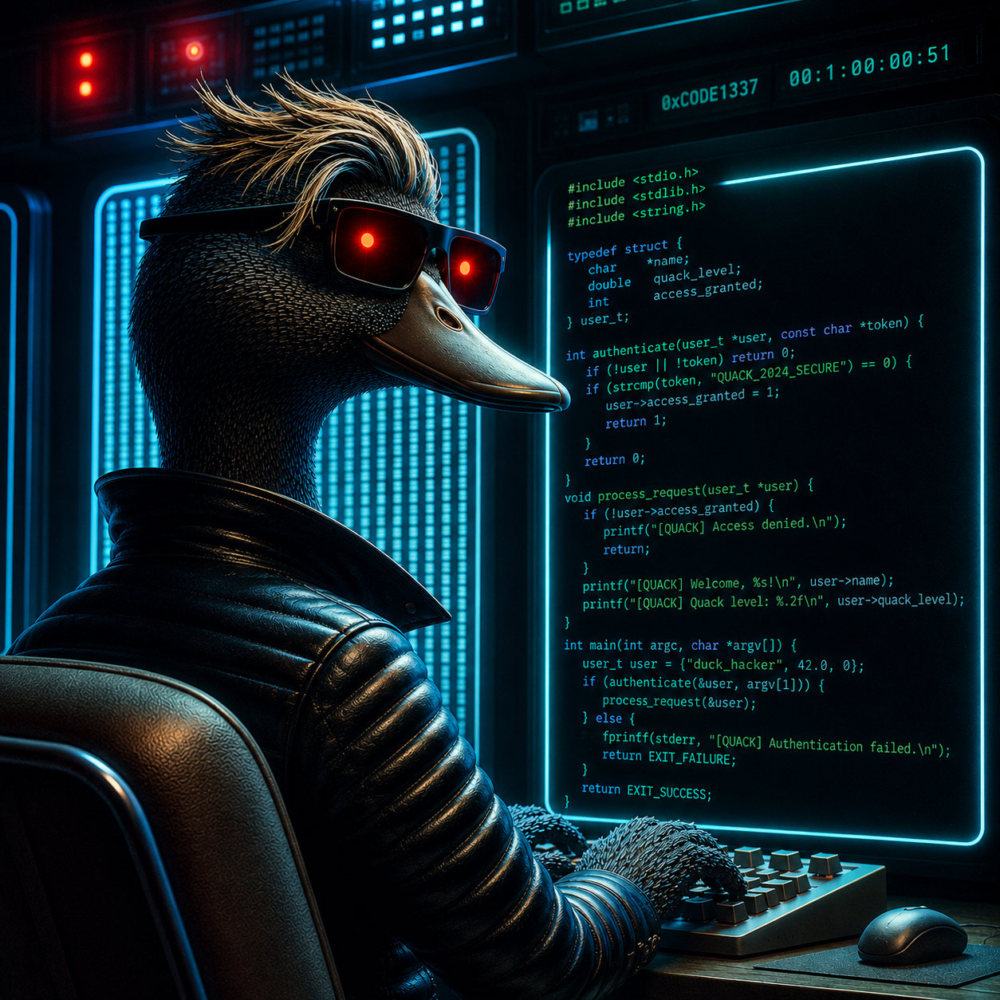

# 🦆 QuAcK: an open-source software for emerging quantum electronic structure methods


---



---

The latest stable release is [QuAcK v1.0](https://github.com/pfloos/QuAcK/releases/tag/v1.0). See the [changelog](CHANGELOG.md) for changes since the 0.9 prerelease.

## 👥 Contributors

- [Pierre-Francois Loos](https://pfloos.github.io/WEB_LOOS)
- [Anthony Scemama](https://scemama.github.io)
- [Enzo Monino](https://enzomonino.github.io)
- [Antoine Marie](https://antoine-marie.github.io)
- [Abdallah Ammar](https://scholar.google.com/citations?user=y437T5sAAAAJ&hl=en)
- [Mauricio Rodriguez-Mayorga](https://scholar.google.com/citations?user=OLGOgQgAAAAJ&hl=es)
- [Loris Burth](https://github.com/lburth)

This list includes contributors credited in the project and people identified in the [commit history](https://github.com/pfloos/QuAcK/commits/v1.0/).

---

## 🚀 Features

- **Rapid Prototyping:** Ideal for testing and developing new quantum chemistry methods.
- **Modular Design:** Easily integrate with other tools and libraries.
- **Educational Tool:** Serves as an excellent entry point for researchers familiar with electronic structure theory.
- **Integration with PySCF:** Utilizes [PySCF](https://github.com/pyscf/pyscf) for computing one- and two-electron integrals.

---

## What is it?

**QuAcK** is a lightweight electronic structure program written in `Fortran 90`, developed at the [Laboratoire de Chimie et Physique Quantiques (LCPQ)](https://www.lcpq.ups-tlse.fr) in Toulouse, France. Originally designed as a platform for rapid prototyping of new ideas in quantum chemistry, QuAcK serves as a flexible and accessible environment for testing novel methods before integrating them more efficiently into larger-scale projects such as the [Quantum Package](https://quantumpackage.github.io/qp2/).

Thanks to its compact and transparent codebase, QuAcK is particularly well-suited for experienced PhD students and postdoctoral researchers who are already familiar with electronic structure theory and want to quickly implement or explore new concepts. Written in a clean and relatively straightforward programming language, it provides an excellent entry point for those looking to dive into method development.

For beginners in the field or those with less programming experience, we recommend starting with [qcmath](https://github.com/LCPQ/qcmath/), a symbolic and numerical quantum chemistry toolkit built in [Mathematica](https://www.wolfram.com/mathematica/). qcmath is specifically designed to help newcomers explore and develop ideas without the complexity of full-fledged numerical implementations.

> ⚠️ **Note:** QuAcK is under active and ongoing development, which means that bugs, inconsistencies, and incomplete features are to be expected. It is a tool made *by* experts *for* experts—users are expected to understand what they’re doing and to remain cautious when interpreting results. The code may allow questionable inputs or behavior *on purpose*, to encourage flexibility during prototyping—so always double-check your results and assumptions. In short: use QuAcK at your own risk—but also to your advantage, if you're ready to experiment and explore.

---

## 🛠️ Installation

Install the compilers, build tools, and libraries listed in the [v1.0 quickstart](https://github.com/pfloos/QuAcK/blob/v1.0/docs/quickstart.md). Clone into a path without spaces.

```bash
git clone --branch v1.0 https://github.com/pfloos/QuAcK.git
cd QuAcK
export QUACK_ROOT="$PWD"
python3 -m venv .venv
source .venv/bin/activate
python -m pip install pyscf
make -C src
```

## ⚡ Quick Start

See the [QuAcK manual](https://pfloos.github.io/QuAcK/manual.html) for the method availability table, the PyDuck command line, and the input reference.
The [quickstart](docs/quickstart.md) shows how to run RHF, GW, and standalone FTDA.


Run the water ionization example from the repository root.

```bash
python docs/examples/run.py water-gw
```

## How to cite QuAcK

Cite the version used in your work. For this release, use the citation below or export BibTeX or APA from GitHub’s **Cite this repository** menu. The machine-readable citation is in [`CITATION.cff`](CITATION.cff).

> Loos, P.-F. (2026). *QuAcK: A software for emerging quantum electronic structure methods* (Version 1.0) [Computer software]. GitHub. https://github.com/pfloos/QuAcK/releases/tag/v1.0

For a development build, record the Git commit printed in the calculation output. Cite the relevant method papers when reporting method-specific results.

---

## 📄 License

QuAcK is distributed under the GNU General Public License, version 3 or later, as stated in the program banner. See [LICENSE](LICENSE) for the GPL v3 text.

---

## 📫 Contact

For questions or contributions, please open an issue or submit a pull request on the [GitHub repository](https://github.com/pfloos/QuAcK).

--- 

## 💰 Funding


QuAcK is supported by the [PTEROSOR](https://lcpq.github.io/PTEROSOR/) project that has received funding from the European Research Council (ERC) under the European Union’s Horizon 2020 research and innovation programme (Grant agreement No. 863481).

---

See the manual for [single-shot GW–Parquet](docs/gw-parquet.md) and [standalone Faddeev](docs/faddeev.md).
