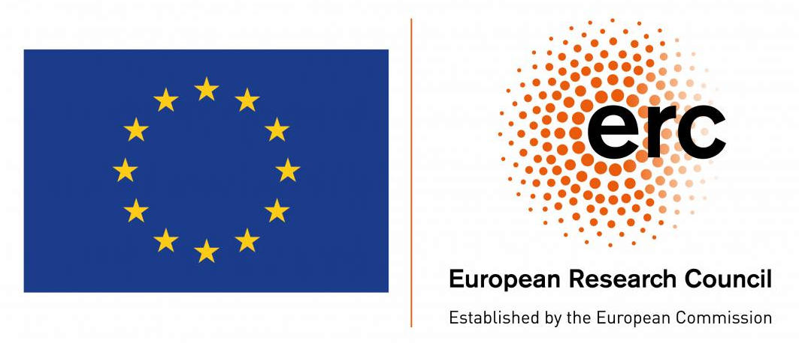

<header class="container project-intro">
  <h1>QuAcK project</h1>
  
Developed at the <a href="https://www.lcpq.ups-tlse.fr">Laboratoire de Chimie et Physique Quantiques</a> in Toulouse, France.

  <ul class="project-links">
    <li><a class="text-link" href="#contributors">Contributors</a></li>
    <li><a class="text-link" href="#cite-quack">Citation</a></li>
    <li><a class="text-link" href="#funding">Funding</a></li>
  </ul>
</header>

<section class="project-band" id="cite-quack" aria-labelledby="citation-title">
  

    <h2 id="citation-title">Cite QuAcK</h2>
    
P.-F. Loos, A. Scemama, E. Monino, A. Marie, A. Ammar, M. Rodriguez-Mayorga, and L. Burth, <cite>QuAcK: A software for emerging quantum electronic structure methods</cite>, version 1.0 (2026).

    
Cite the version you used.

    <ul class="project-links">
      <li><a class="text-link" href="https://github.com/pfloos/QuAcK/releases/tag/v1.0">Version 1.0 release</a></li>
      <li><a class="text-link" href="https://github.com/pfloos/QuAcK/blob/master/CITATION.cff">Citation file</a></li>
    </ul>
  

</section>

<section class="container project-section" id="contributors" aria-labelledby="contributors-title">
  <h2 id="contributors-title">Contributors</h2>
  <ul class="contributors-list">
    <li><a href="https://pfloos.github.io/WEB_LOOS">Pierre-François Loos</a></li>
    <li><a href="https://scemama.github.io">Anthony Scemama</a></li>
    <li><a href="https://enzomonino.github.io">Enzo Monino</a></li>
    <li><a href="https://antoine-marie.github.io">Antoine Marie</a></li>
    <li><a href="https://scholar.google.com/citations?user=y437T5sAAAAJ&amp;hl=en">Abdallah Ammar</a></li>
    <li><a href="https://scholar.google.com/citations?user=OLGOgQgAAAAJ&amp;hl=es">Mauricio Rodriguez-Mayorga</a></li>
    <li><a href="https://github.com/lburth">Loris Burth</a></li>
  </ul>
</section>

<section class="project-band" id="funding" aria-labelledby="funding-title">
  

    <h2 id="funding-title">Funding</h2>
    <ul class="support-list">
      <li>
        
        <h3>European Research Council (ERC)</h3>
        
The <a href="https://lcpq.github.io/PTEROSOR/">PTEROSOR project</a> received funding under the European Union’s Horizon 2020 research and innovation programme, grant agreement <strong>863481</strong>.

      </li>
    </ul>
  

</section>
